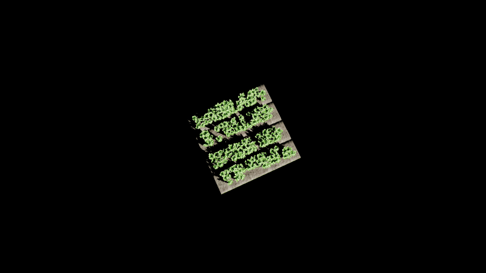

# CropVolume

Generate random Unreal crop fields and pair each Gaussian reconstruction with its known plant volume and reproducible metadata. Configure and launch batches from a local dashboard, watch progress and stage timings, and stop, resume or clear runs there.

The default layout reuses the supplied BaseSim field's planting rows and gaps. Only the requested field is rendered; the exterior is black. Plant variants, scale and occupancy vary with the seed. Audited mesh volumes are reused with transform scaling, with overlap corrections where needed. Reconstruction scores are recorded without filtering pairs. Training a future volume-prediction neural network is outside this project.



## Requirements

The tested capture setup uses **Windows Unreal Engine 5.8.4 and Python 3.12 in WSL2**, with a working GPU-enabled PyTorch environment and a C++ compiler/toolkit for gsplat. The Radeon profile was tested on an RX 7900 XT, ROCm 7.2 and PyTorch 2.9.1. A pinned CUDA gsplat adapter is also included; NVIDIA execution has not been validated here. CPU tests and asset checks do not require Unreal or a GPU.

The field, four approved solid meshes, materials and pinned ROCm gsplat source are bundled. **The original BaseSim/Basegsplat folders and another person's dataset drive are not required.** Unreal itself, GPU drivers and PyTorch are installed separately.

## Setup

Extract the release or clone this repository, then run from its root:

```bash
python3.12 -m venv .venv
source .venv/bin/activate
python -m pip install -e '.[test,colmap]'
python tools/doctor.py --assets-only
```

On Ubuntu, creating the environment requires the `python3.12-venv` system package. Install GPU-enabled PyTorch in the environment you will use for training, following the [official PyTorch installation selector](https://pytorch.org/get-started/locally/). Then install the corresponding adapter requirements:

```bash
# AMD / ROCm: uses the bundled native-HIP gsplat source
python -m pip install -r pipeline/requirements-training-rocm.txt

# NVIDIA / CUDA: alternative to the ROCm requirements
# python -m pip install -r pipeline/requirements-training.txt
```

Set your own paths; these are examples, not required drive letters:

```bash
python tools/configure.py \
  --output-root /mnt/d/CropVolumeData \
  --runtime-root /mnt/d/CropVolumeRuntime \
  --engine-root 'C:/Program Files/Epic Games/UE_5.8' \
  --training-python "$VIRTUAL_ENV/bin/python" \
  --backend rocm
python tools/doctor.py --gpu
python tools/dashboard.py
```

You may point `--training-python` at an existing GPU environment. It must use the same Python minor version as the dashboard environment. The launcher makes the dashboard's CPU dependencies available to that interpreter. For a separate, already configured GPU environment, install the lightweight helpers in the dashboard environment with `python -m pip install --no-deps -r pipeline/requirements-training-rocm.txt`; this reuses the existing PyTorch installation without downloading another one. On first use the GPU extension is compiled into the configured cache; later runs reuse it.

Open **http://localhost:8765**. The dashboard is hosted locally and binds only to `127.0.0.1`. Each user runs their own local instance; this release does not publish or deploy a hosted service. The original flight-school game and a C++ Unreal game-module build are not needed; capture stages an editor-only working project automatically.

## Choose where files go

Use **Output folder** in the dashboard before clicking **Generate pairs**. It accepts an absolute WSL path, `~/...`, or a Windows drive path such as `D:\CropVolumeData`. The selected folder is checked for write access and remembered locally. Earlier output folders remain visible, and their runs can still be stopped, resumed or cleaned up.

You can also set the default at startup:

```bash
python tools/dashboard.py --generation-root /mnt/d/MyDataset
# or
CROPVOLUME_OUTPUT_ROOT=/mnt/d/MyDataset python tools/dashboard.py
```

Each run creates its own `random-field-...` subfolder. The output directory may be on a Windows drive or in the WSL filesystem. **The Unreal runtime directory must be on a Windows drive** because the Windows editor opens its project there. It is independent of the dataset output directory. Source assets remain separate from both.

Machine settings are stored in ignored `cropvolume.local.json`; `cropvolume.example.json` documents the shape. Environment variables override local settings. See [configuration details](docs/CONFIGURATION.md).

## Generate and inspect data

Configure field width/length, image width/height, camera height, maximum Gaussians, number of pairs and seed. Advanced settings include BaseSim rows or scatter, mesh scale, minimum spacing, views, training steps and camera target height. Camera height sets the camera's altitude; target height sets where it aims above the field center.

Plant counts derive from usable BaseSim row positions, maximum mesh scale and spacing. With a 4×4 m field, scale 0.8–1.2 and 0.08 m spacing, the range is 164–183 plants. Scatter retains a 5–10 plants/m² policy. Counts, field size, assets, transforms and seeds are recorded with each sample. The memory estimate follows the chosen settings; it is advisory, not a guaranteed upper bound. Pairs run sequentially.

Choose **View dataset → Samples & captures** to see each field's total plant volume in liters. Files for each sample include:

```text
random-field-.../samples/<sample-id>/
  scene.json                 # plants, transforms, random seed and field bounds
  capture.json               # authoritative camera poses/intrinsics
  images/                    # Unreal photographs
  labels/volume.json         # plant_solid_volume_m3, excluding soil
  splat.ply                  # reconstructed Gaussian representation
  metadata.json              # settings, label scope and recorded metrics
  COMPLETE.json              # immutable completion/checksum receipt
```

The volume uses the rendered synthetic solid geometry, including a documented 0.3 mm leaf thickness; it is not a biological measurement. Overlaps count once. A multi-field run has a separate volume label for every field.

**Stop now / Release run memory** exits the run's Python/Unreal processes. **Clear temporary files** retains photographs and published pairs; **Delete run** removes the selected run. File cleanup shows a preview and requires confirmation. Existing completed pairs are reused on resume. Run settings are immutable; use a new run to change them. Historical runs keep their saved renderer settings.

